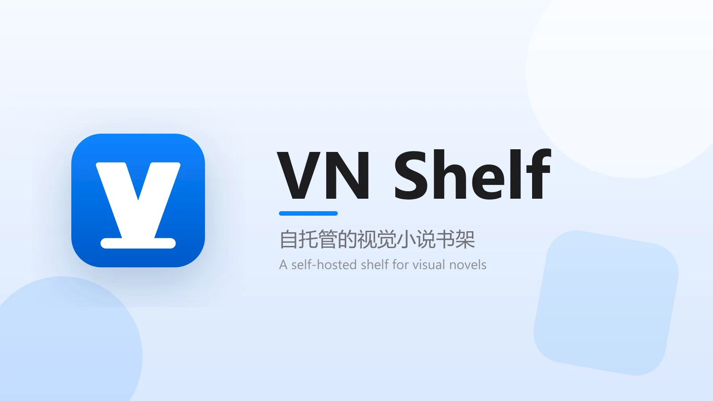

<h1 align="center">VN Shelf</h1>

  

  
  
  
  

  

运行在 Cloudflare Workers 生态上的视觉小说（Visual Novel）书架管理应用，支持从 VNDB 数据拉取、分级 Tier 展示、批量索引、导入导出与游玩统计

## 功能特性

- VN 条目可视化管理：创建、更新、删除、按条件检索
- VNDB 集成：从 VNDB 自动拉取标题、封面、评分、时长、开发商、标签等信息
- Tier List：支持分层展示、拖拽排序、跨 Tier 移动
- 认证系统：管理员初始化、登录态校验、JWT + HttpOnly Cookie
- 批量索引：基于 Cloudflare Queues 异步刷新条目 VNDB 信息
- 导入/导出：支持库数据备份与迁移（含 Tier 列表）
- 标签翻译：前端 IndexedDB 缓存 + 后台版本更新机制

## 快速开始

> 前置条件：GitHub 账号 + Cloudflare 账号（免费套餐即可）。可选 Secrets、自定义域名、Turnstile 登录验证等完整配置见[部署指南](docs/deployment.md)。

1. Fork 本仓库。
2. 打开 [一键预填链接](https://dash.cloudflare.com/?to=/:account/api-tokens/create?permissionGroupKeys=%5B%7B%22key%22%3A%22workers_scripts%22%2C%22type%22%3A%22edit%22%7D%2C%7B%22key%22%3A%22d1%22%2C%22type%22%3A%22edit%22%7D%2C%7B%22key%22%3A%22queues%22%2C%22type%22%3A%22edit%22%7D%2C%7B%22key%22%3A%22account_settings%22%2C%22type%22%3A%22read%22%7D%5D&accountId=%2A&zoneId=all&name=VN%20Shelf%20Deploy) 创建 Cloudflare API Token：权限已自动填好，确认表单中四条权限齐全后点击“继续以显示摘要” -> “创建令牌”，复制令牌。
3. 在你 Fork 的仓库进入 "Settings" -> "Secrets and variables" -> "Actions"，添加 Secret `CF_API_TOKEN`（值即上一步复制的令牌）。
4. 进入 "Actions" 页运行 "Deploy to Cloudflare" 工作流：D1 数据库与 Queue 会自动创建，Worker 使用默认名 `vn-shelf`。
5. 部署完成后访问 `https://vn-shelf.<你的子域>.workers.dev`，按页面提示初始化管理员密码即可开始使用。

## 文档

| 文档 | 说明 |
| --- | --- |
| [部署指南](docs/deployment.md) | Secrets 一览、API Token 获取、D1/Queue 自动预检、自定义域名与 Turnstile 登录人机验证 |
| [本地开发](docs/development.md) | 环境准备、`wrangler.toml` 配置与常用命令 |

## API 说明

所有接口均在 `/api/*` 前缀下，返回 JSON。列表/详情读取、统计与外观配置为公开接口；其余（全部写操作及部分管理用查询）需管理员登录（JWT + HttpOnly Cookie）。

| 分组 | 端点 | 说明 |
|------|------|------|
| 认证 | `GET /api/auth/status`、`GET /api/auth/verify`、`POST /api/auth/init`、`POST /api/auth/login`、`POST /api/auth/logout` | 管理员初始化、登录与登出 |
| VN 条目 | `GET` / `POST /api/vn`、`GET` / `PUT` / `DELETE /api/vn/{id}` | 条目增删改查；`PUT` 支持 `refreshVNDB` 从 VNDB 刷新 |
| Tier 归属 | `PUT /api/vn/{id}/tier`、`PUT /api/vn/tier/batch` | 单条 / 批量（上限 200）Tier 归属与排序 |
| Tier 列表 | `GET` / `POST /api/tier`、`PUT /api/tier/order`、`PUT` / `DELETE /api/tier/{id}` | Tier 增删改与排序 |
| 统计 | `GET /api/stats` | 概览、状态计数、评分直方图、完成时间线、Top 榜 |
| 索引与导入 | `POST /api/index/start`、`GET /api/index/status`、`POST /api/ulist/import` | 批量索引与 VNDB ulist 用户列表导入 |
| VNDB 搜索 | `GET /api/vndb/search` | 添加条目弹窗的候选搜索 |
| 配置 | `GET` / `PUT /api/config`、`GET /api/config/appearance`、`POST /api/config/turnstile/test` | Token / 密码 / tags / 外观；`appearance` 为公开只读；`turnstile/test` 用输入值预验 Turnstile 密钥对 |
| 备份 | `GET /api/export`、`POST /api/import` | 导出 / 导入库数据（含 Tier 列表，支持 `merge` / `replace`） |

请求参数、数据结构与内部实现等技术详情见 [AGENTS.md](./AGENTS.md)。

## 技术栈

- 运行时：Cloudflare Workers（ES Modules）
- 存储：Cloudflare D1
- 队列：Cloudflare Queues
- 前端：原生 HTML/CSS/JavaScript（无构建步骤）
- 测试：Node.js 内置测试运行器（`node --test`）
- 代码质量：ESLint

## 许可证

MIT License。详见 [LICENSE](./LICENSE)
